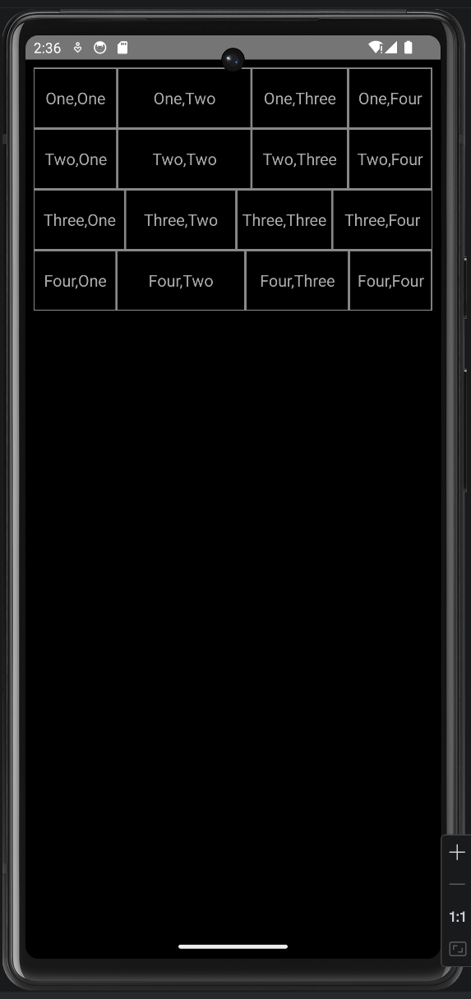
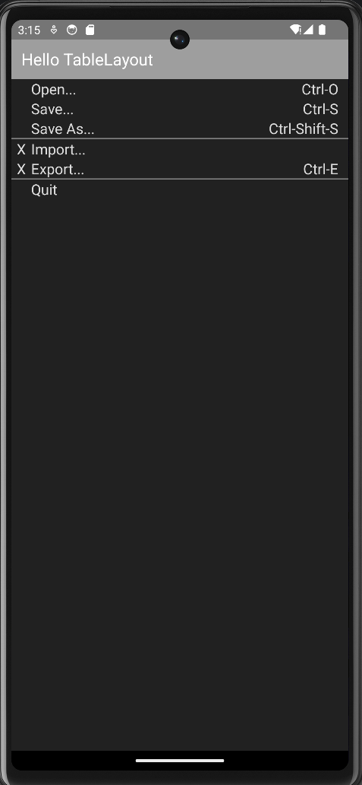
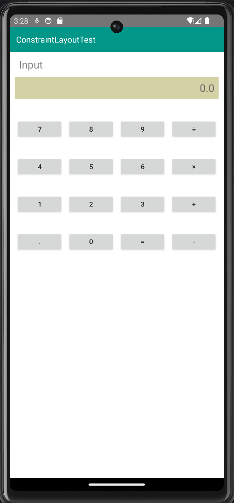
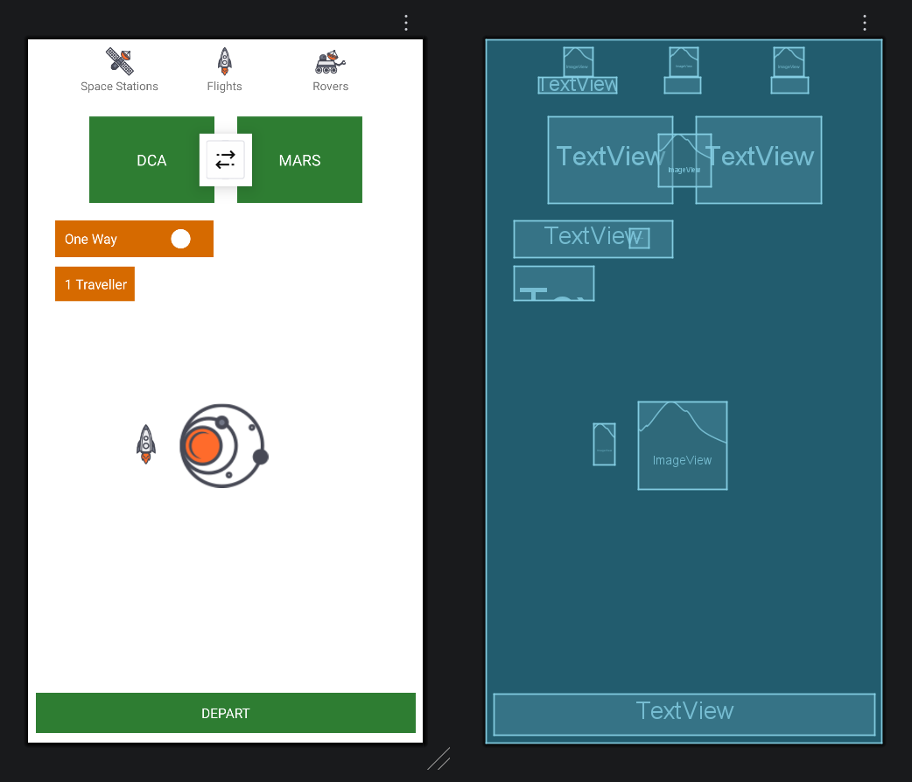
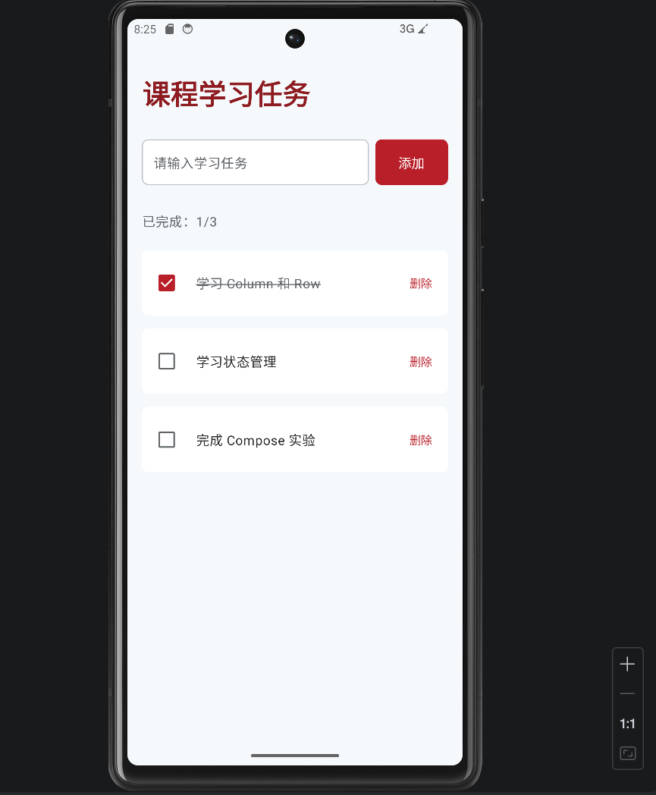
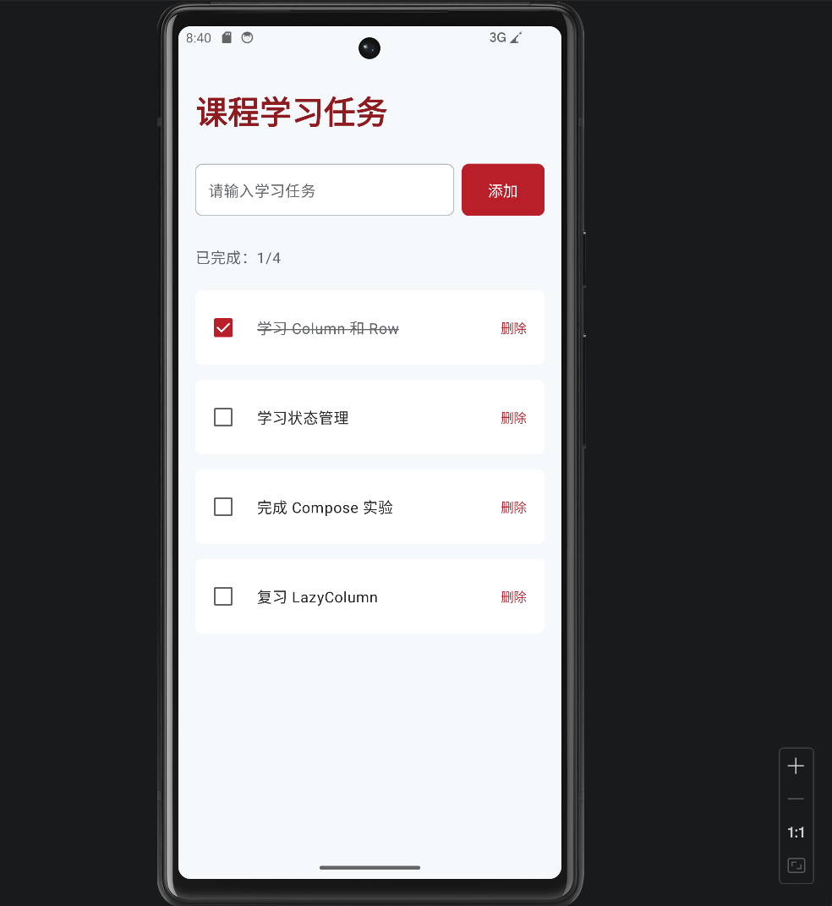
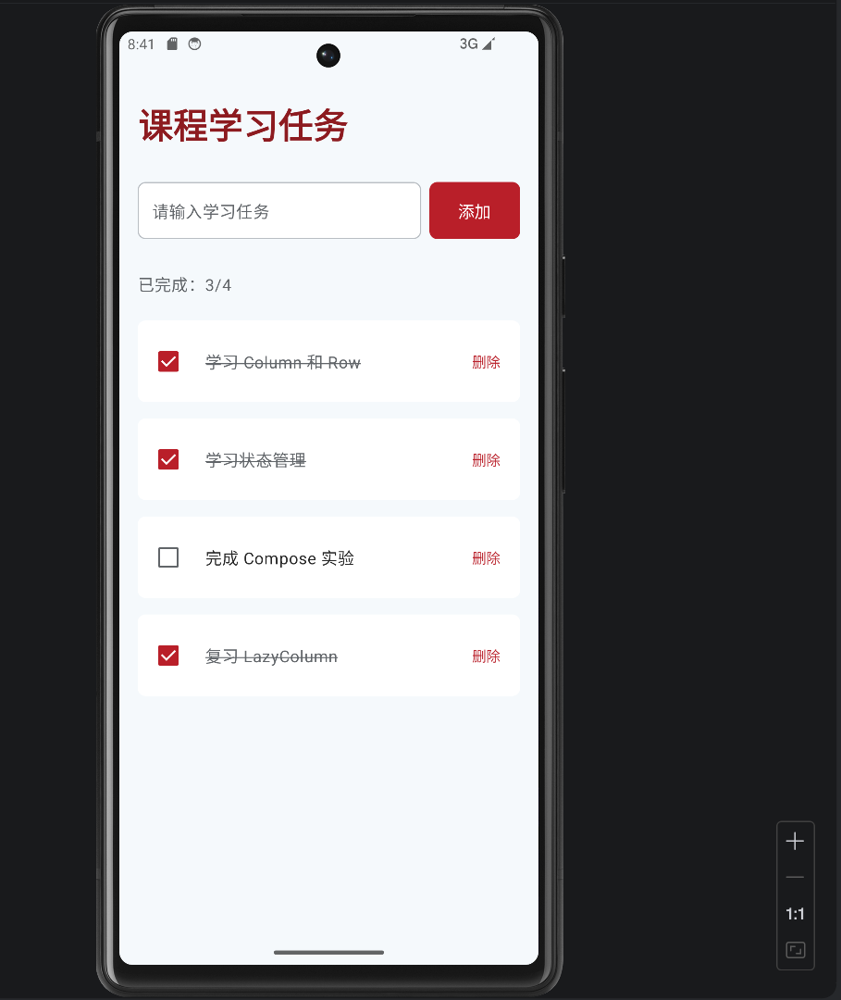

# Android 界面布局实验报告

## 一、实验目的

1. 熟悉 Android Studio 开发环境，掌握 Android 项目的创建、编译和运行。
2. 学习 Android 常用布局，包括 LinearLayout、TableLayout 和 ConstraintLayout。
3. 掌握 XML 布局文件的编写方式，以及常用控件的属性设置。
4. 学习 Jetpack Compose 声明式界面开发，理解状态管理和界面更新机制。
5. 掌握使用 Git 和 GitHub 管理 Android 实验项目的方法。

## 二、实验环境

| 项目 | 实验环境 |
|---|---|
| 开发工具 | Android Studio |
| 开发语言 | Kotlin、XML |
| 操作系统 | Windows |
| 测试设备 | Pixel 6 模拟器 |
| 模拟器系统 | Android 14（API 34） |
| UI 开发技术 | Android Views、Jetpack Compose |
| 版本管理 | Git、GitHub |

## 三、实验内容与实现过程

### 3.1 LinearLayout 线性布局

**实验要求：**

利用 LinearLayout 实现一个包含四行、每行四个文本单元格的布局界面。

**实现过程：**

使用一个垂直方向的 LinearLayout 作为根布局，再嵌套四个水平方向的 LinearLayout。每个水平布局包含四个 TextView，分别显示对应的行列文字。

通过 `android:orientation` 控制布局方向，利用 `android:layout_weight` 设置各单元格的宽度比例，实现不同行之间错落的分隔效果。

使用 Drawable 资源设置黑色背景和灰色边框，并调整文字大小，保证所有文本单行显示。

**实验结果：**

成功实现四行四列的线性布局，掌握了 LinearLayout 嵌套以及权重分配的使用方法。

### 3.2 TableLayout 表格布局

**实验要求：**

使用 TableLayout 实现类似应用菜单的界面，包含 Open、Save、Save As、Import、Export 和 Quit 等菜单项及部分快捷键。

**实现过程：**

使用 TableLayout 作为根布局，通过多个 TableRow 组织菜单内容。

采用三列结构，分别表示菜单标记、菜单名称及快捷键。

利用 `android:stretchColumns` 设置可伸展列，使菜单文字和快捷键保持合理的对齐关系。

通过背景颜色、文本颜色以及分隔线实现深色菜单界面。

**实验结果：**

实现了菜单项和快捷键的对齐，并将 Import、Export 前的 X 标记独立成列，加深了对 TableLayout 行列组织方式的理解。

### 3.3 ConstraintLayout 约束布局一：计算器界面

**实验要求：**

利用 ConstraintLayout 实现计算器界面，包含输入提示、结果显示区域及数字和运算符按钮。

**实现过程：**

以 ConstraintLayout 为根布局，添加 TextView 显示 Input 和初始结果 0.0。

使用 Button 构建四行四列的计算器键盘，包括数字、加减乘除和等号等控件。

通过 `layout_constraintTop_toBottomOf`、`layout_constraintStart_toStartOf` 等属性建立控件之间的约束关系。

调整按钮尺寸、间距和背景颜色，使界面接近实验参考图。

**实验结果：**

完成计算器静态界面的布局，掌握了 ConstraintLayout 中控件之间的相对定位与约束设置。

本实验主要实现界面布局，未实现实际计算功能。

### 3.4 ConstraintLayout 约束布局二：航天旅行界面

**实验要求：**

根据给定图片资源，使用 ConstraintLayout 实现航天旅行主题界面。

**实现过程：**

首先将提供的图片资源导入 `res/drawable` 目录，包括空间站、火箭、探测车、星球及双向箭头等。

然后使用 ConstraintLayout 构建页面，主要包含：

- 顶部 Space Stations、Flights、Rovers 导航区域；
- DCA 和 MARS 出发地、目的地区域；
- 位于两个绿色区域之间的双向箭头；
- One Way 和 1 Traveller 信息区域；
- 中部火箭及星球图片；
- 底部 DEPART 按钮区域。

通过设置水平和垂直约束、margin、bias 等属性调整控件位置。

使用 Android Studio 的 Design 和 Blueprint 视图观察布局效果，并根据参考图进行调整。

**实验结果：**

完成航天旅行主题界面的静态布局。通过本实验，进一步掌握了 ConstraintLayout 的约束关系、控件叠加和图片资源使用方法。

### 3.5 Jetpack Compose 实验：课程学习任务列表

**实验要求：**

使用 Jetpack Compose 实现课程学习任务管理界面，支持任务添加、勾选完成、删除以及完成数量统计。

**实现过程：**

使用 `Column` 组织整体页面，通过 `Row` 排列输入框、添加按钮以及任务列表中的各个元素。

使用 `LazyColumn` 动态展示任务。

创建 StudyTask 数据类，保存任务编号、任务名称和完成状态。

使用 `remember`、`mutableStateOf` 和 `mutableStateListOf` 管理界面状态。

实现以下功能：

1. 初始显示三项任务，其中一项已完成。
2. 在输入框输入任务名称，点击添加按钮新增任务。
3. 勾选复选框后，任务完成状态发生变化。
4. 已完成任务自动显示删除线。
5. 根据任务状态实时统计已完成数量。
6. 点击删除按钮移除指定任务。

**实验结果：**

课程学习任务列表成功运行，初始状态显示“已完成：1/3”，已完成任务显示删除线。通过本实验，理解了 Jetpack Compose 中状态变化驱动界面更新的基本原理。

## 四、实验运行结果截图

### 4.1 LinearLayout 运行效果

### 4.2 TableLayout 运行效果

### 4.3 ConstraintLayout 1 运行效果

### 4.4 ConstraintLayout 2 运行效果

### 4.5 Jetpack Compose 运行效果

**（1）初始状态：3 项任务，完成 1 项**

**（2）添加任务：新增“复习 LazyColumn”**

**（3）状态更新：完成数量和删除线同步变化**

## 五、实验中遇到的问题及解决方法

### 5.1 Android SDK 与依赖版本不匹配

项目创建初期，出现 AndroidX 依赖要求更高 compileSdk 版本的问题。

解决方法：调整项目的 compileSdk 配置，使其满足依赖库的要求。

### 5.2 LinearLayout 中文本自动换行

初始布局中，部分文本由于字体较大、单元格宽度不足而出现换行。

解决方法：调整 TextView 的 textSize，并通过 maxLines 属性限制文本行数。

### 5.3 ConstraintLayout 控件位置调整

航天旅行界面中，最初出现 DCA 和 MARS 间距不合理、箭头位置偏移等问题。

解决方法：利用 ConstraintLayout 的约束属性调整控件位置，并结合 Android Studio 的 Design Preview 和 Blueprint 检查布局结构。

## 六、实验总结

通过本次 Android 界面布局实验，学习并实践了 LinearLayout、TableLayout、ConstraintLayout 和 Jetpack Compose 四种界面开发方式。

LinearLayout 适用于按水平或垂直方向排列控件的场景；TableLayout 适用于具有行列关系的界面；ConstraintLayout 可以通过灵活的约束关系实现较复杂的页面结构。

在 Jetpack Compose 实验中，通过开发课程学习任务列表，进一步理解了声明式 UI 和状态管理机制，认识到数据状态变化可以自动驱动界面更新。

此外，通过 Android Studio 的布局预览、模拟器调试以及 GitHub 版本管理，熟悉了 Android 项目的基本开发流程。

本次实验提高了 Android 界面设计、布局调试和项目管理能力，为后续 Android 应用开发奠定了基础。

## 七、参考资料

1. Android 官方布局开发文档：https://developer.android.google.cn/guide/topics/ui/declaring-layout
2. Jetpack Compose 官方文档：https://developer.android.com/develop/ui
3. 课程实验指导材料：《Android界面布局实验》
